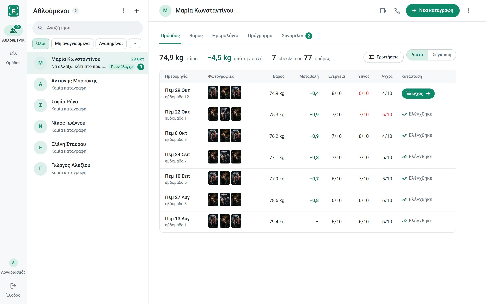
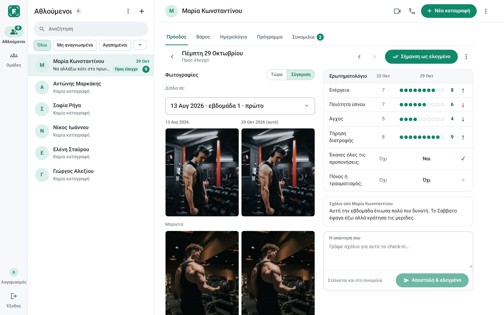
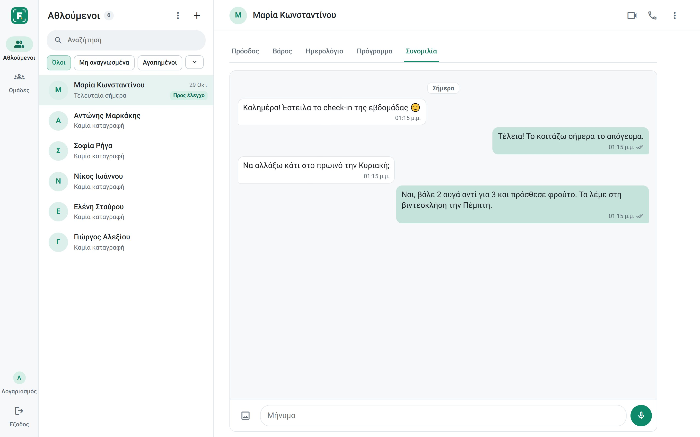
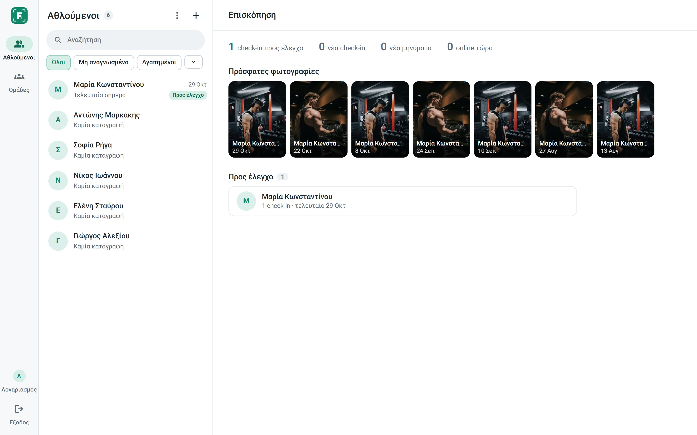
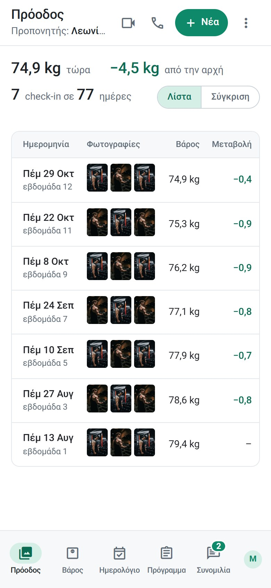

# FormLog

**A workspace for online fitness coaches**: athletes, check-ins, progress photos, conversations and video calls in one place.



> Private beta · Greek-language interface

---

## What it does

**For coaches**
- **Check-ins ready for review**: photos, weight and a 1–10 questionnaire on one screen, with arrows that show what improved and what didn't since the previous check-in.
- **Compare with any date**: put today's photos next to any earlier check-in, even the very first one.
- **"To review" / "Reviewed"**: a reply goes straight to the conversation and marks the check-in as reviewed, so nobody slips through.
- **Custom questions** per athlete (1–10 scale, yes/no or text).
- **Messages, voice notes and photos**, plus **voice and video calls** with screen sharing, inside the app.
- **Groups** with a shared conversation.
- **Training and nutrition plans**: write them or upload a file; athletes download them as PDF.
- **Weight** table and chart, and a daily **journal** (sleep, water, calories, steps) with targets.
- **Overview** of who needs attention today. Everything updates live, with no refresh.

**For athletes**
- A one-minute check-in from the phone: three photos, weight and a few questions.
- Their progress, their plan and their coach's replies, in one place.
- Also works without a coach, for personal use.

| | |
|---|---|
|  |  |
|  |  |

## Tech

- **Next.js 16** (App Router) and **React 19**
- **Supabase**: PostgreSQL, Auth, Storage, Realtime
- **WebRTC** for peer-to-peer voice and video calls (Realtime for signaling)
- **pdf-lib** for PDF export with embedded Greek fonts
- Deployed on **Vercel**

## Security

- **Row Level Security on every table**: each user only reaches their own data and the athletes they coach. Sensitive actions (invitations, calls, reviews) run through database functions that check every step.
- **Private storage** for photos, plans and voice notes; file types and sizes are restricted.
- **Content-Security-Policy** and other security headers (clickjacking, content-type and referrer protection).
- **Rate limits** on invitations, messages and calls.
- Verified with an automated suite of more than 120 attack scenarios (cross-account access, file abuse, XSS, realtime eavesdropping, forged calls and messages).

## Structure

```
app/          pages and the server route for calls
components/   interface (workspace, check-ins, chat, calls, journal, plans)
lib/          data access, authentication, PDF export, helpers
supabase/     database migrations, applied in order (schema, rules, functions)
public/       images and fonts
```

---

© 2026 Κωνσταντίνος Πάλλας. All rights reserved. The code is published for viewing only; see [LICENSE](LICENSE).
